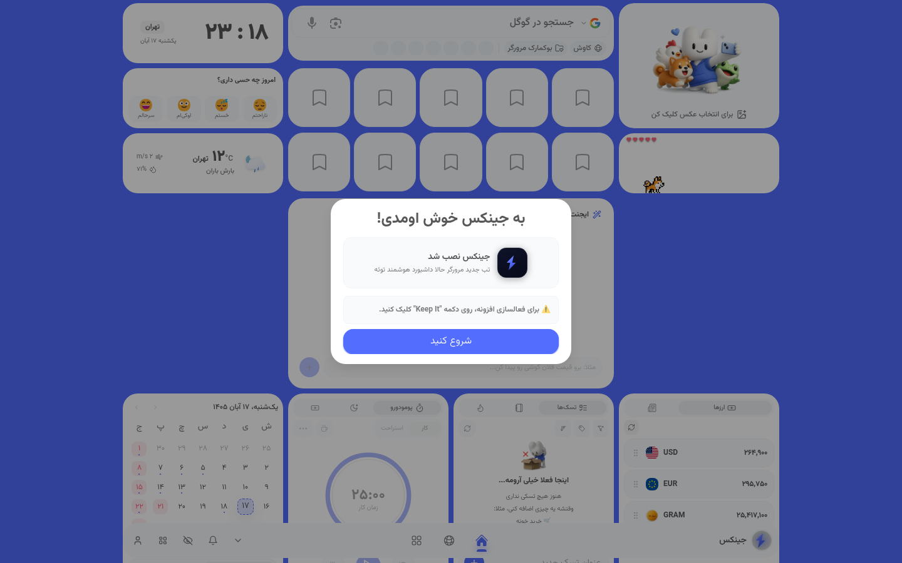

# 🧞 جینکس | Jinx

**داشبورد هوشمند نوب‌تب با ایجنت هوش مصنوعی که مرورگر را کنترل می‌کند — قیمت لحظه‌ای ارز و طلا، آب‌وهوا، تقویم فارسی، تودو، بوکمارک، والپیپر و یک سیستم ویجت کامل.**

`نسخه 27.2.0` · کروم (Manifest V3) + فایرفاکس

**🌐 وب‌سایت افزونه:** [jinx.metora.ir](https://jinx.metora.ir) · **توسعه‌دهنده:** [metora.ir](https://metora.ir)

**📖 English docs:** [README.md](README.md)

---

## 📖 معرفی

جینکس جای نوب‌تب مرورگر شما را با یک **داشبورد هوشمند و فارسی‌محور** عوض می‌کند. این افزونه بر پایه‌ی سورس‌کد [**ویجتی‌فای**](https://widgetify.ir/) ساخته شده — افزونه‌ی نوب‌تب هوشمند ایرانی — و **کاملاً رایگان** است: هیچ قابلیتی قفل نیست و هیچ دیوار پرداختی وجود ندارد. این داشبورد داده‌های لحظه‌ای (ارز، طلا، آب‌وهوا)، ویجت‌های بهره‌وری (تودو، عادت‌ها، یادداشت، پومودورو، بوکمارک، تقویم) و یک **ایجنت هوش مصنوعی کنترل‌کننده‌ی مرورگر** را با هم دارد که با مدل‌های اختصاصی متورا (`jinx-1-air` و `jinx-3-legion`) کار می‌کند.

هر چیزی که داشبورد برای نمایش لازم دارد **داخل خود افزونه بسته‌بندی شده** — فونت‌های فارسی (صمیم و وزیرمتن)، والپیپرها، صداها و آیکون‌ها — پس نوب‌تب شما حتی با اینترنت کند هم فوری بالا می‌آید.

> اسکرین‌شات، داشبورد واقعی در اجرای اول را نشان می‌دهد: ساعت و تاریخ تهران، انتخاب حال روحی، آب‌وهوا، کاشی‌های بوکمارک، حیوان خانگی مجازی، تقویم فارسی، پومودورو، یادداشت‌ها و ویجت لحظه‌ای دلار / یورو / طلا — به‌همراه دکمه‌ی هوش مصنوعی در داک پایین.

## ✨ ویژگی‌ها

**🤖 ایجنت هوش مصنوعی جینکس**
- ایجنتی گفتگومحور که می‌تواند **مرورگر را کنترل کند**: بازکردن تب، جستجو در وب، انجام کار روی صفحات و پاسخ به سؤال‌ها
- با مدل‌های درون‌سازمانی متورا **Jinx-1-Air** و **Jinx-3-Legion** (`api.metora.ir/v1`) کار می‌کند
- از دکمه‌ی شناور هوش مصنوعی در داک پایین، همه‌جا در دسترس است

**📊 داشبورد لحظه‌ای**
- 💱 **ارز و طلا** — قیمت لحظه‌ای دلار، یورو، طلا و گرم با تغییرات روزانه؛ به‌روزرسانی خودکار و کش هوشمند
- 🌤️ **آب‌وهوا** — وضعیت فعلی شهر شما
- 📅 **تقویم فارسی (جلالی)** + ساعت جهانی با منطقه‌های زمانی دلخواه
- 📰 **فید RSS** — منابع دلخواه خودتان را به‌شکل ویجت اضافه کنید

**🧩 سیستم ویجت**
- بیش از ۱۰ ویجت روی **چیدمان شبکه‌ای قابل کشیدن**: افزودن، تغییر اندازه، جابه‌جایی، تکثیر و حذف
- **ویجت ترکیبی (Combo)** — چند ابزار کوچک را در یک کاشی جمع کنید
- **حالت بوم (Canvas)** و تنظیمات و واریانت‌های هر ویجت

**✅ بهره‌وری**
- **تودو و عادت‌ها** — هدف روزانه، تناوب دلخواه، زنجیره‌ی استریک، تگ و فیلتر تاریخ
- **یادداشت‌ها** — یادداشت‌های سریع روی نوب‌تب
- تایمر **پومودورو** با نشست‌های تمرکز
- **بوکمارک‌ها** — کاشی‌های بوکمارک تصویری با پوشه‌های قابل کشیدن و رها کردن

**🎨 شخصی‌سازی**
- 🖼️ **والپیپرها** — والپیپرهای داخلی به‌همراه کلکسیون‌های آنلاین، با حالت محو و فیلتر تگ
- 😀 **انتخاب حال روحی** — «امروز چه حسی داری؟»
- 🐴 **حیوان خانگی مجازی** — یک همراه کوچک روی داشبورد شما
- 👥 **دوستان** — دوستان را اضافه کنید و تنظیماتتان را به اشتراک بگذارید
- 🔔 **هشدارها و صداها** — هشدار بازار و کارها (صدای داخلی)

**👨‍💼 حساب کاربری**
- با **حساب متورا** وارد شوید تا چیدمانتان بین دستگاه‌ها همگام شود
- **۱۰۰٪ رایگان** — بدون اشتراک، بدون دیوار پرداخت، بدون قابلیت قفل‌شده

## 🧱 معماری

این ریپو شامل **بیلد رسمی و آماده‌ی انتشار** افزونه است.

| مسیر | چیست |
|---|---|
| `manifest.json` | مانیفست افزونه (MV3) — دسترسی‌ها، آیکون‌ها، جانشین‌شدن نوب‌تب |
| `background.js` | **سرویس‌ورکر** MV3 — مرکز پیام‌رسانی بین داشبورد، تب‌ها و سرویس هوش مصنوعی |
| `newtab.html` | نقطه‌ی ورودی که جای نوب‌تب مرورگر را می‌گیرد |
| `chunks/` | ماژول‌های React تفکیک‌شده با Vite (داشبورد، احراز هویت، پرداخت، ویجت‌ها، هوش مصنوعی و…) |
| `assets/` | فونت‌های فارسی باندل‌شده (**صمیم**، **وزیرمتن**)، والپیپرها، صداها، CSS |
| `cdn/` | رسانه‌های بیشتر: کلیپ‌های آموزشی، هشدارها، تصاویر رابط |
| `icons/` | آیکون‌های تولبار و استور (۱۶ تا ۵۱۲ پیکسل) |

**شناسه‌های افزونه در این بیلد:** شناسه‌ی فایرفاکس `jinx@metora.ir` (گکو ≥ ۱۱۵). نصب کروم از طریق وب‌استور یا «Load unpacked» انجام می‌شود.

## 📦 نصب

**کروم / اج / هر مرورگر Chromium**

1. این ریپو را دانلود کنید (`Code → Download ZIP`) و از حالت فشرده خارج کنید — یا `git clone` بزنید.
2. آدرس `chrome://extensions` را باز کنید.
3. **Developer mode** را (بالا سمت راست) روشن کنید.
4. روی **Load unpacked** بزنید و پوشه‌ی ریپو را (پوشه‌ای که `manifest.json` مستقیم داخلش است) انتخاب کنید.
5. یک تب جدید باز کنید — جینکس جای آن را می‌گیرد. 🎉

**فایرفاکس**

1. آدرس `about:debugging#/runtime/this-firefox` را باز کنید.
2. روی **Load Temporary Add-on…** بزنید و `manifest.json` را انتخاب کنید.
3. یک تب جدید باز کنید. (افزونه‌های موقت با ری‌استارت فایرفاکس حذف می‌شوند.)

> 💡 اگر افزونه‌ی نوب‌تب دیگری نصب دارید، فقط یکی را نگه دارید — بر سر نوب‌تب با هم تداخل می‌کنند. وقتی کروم پرسید، داشبورد را با **Keep It** تأیید کنید.

## 🔐 دسترسی‌ها و حریم خصوصی

جینکس هم یک داشبورد است و هم یک ایجنت مرورگر، پس بیشتر از یک افزونه‌ی معمولی دسترسی می‌خواهد. کاربرد هر دسترسی:

| دسترسی | دلیل |
|---|---|
| `storage` و `unlimitedStorage` | چیدمان، ویجت‌ها، یادداشت‌ها و تنظیمات شما به‌صورت محلی داخل مرورگر ذخیره می‌شود |
| `tabs` | کاشی‌های بوکمارک، شمارنده‌ی تب‌ها و کارهای تب‌محورِ ایجنت هوش مصنوعی |
| `search` | ایجنت هوش مصنوعی و کادر جستجو می‌توانند جستجوی وب اجرا کنند |
| `scripting` و `activeTab` | کارهای درخواستی روی صفحه‌ها از طریق ایجنت هوش مصنوعی |
| `tabGroups`، `bookmarks`، `identity` *(اختیاری)* | فقط وقتی از ویژگی مرتبط استفاده کنید فعال می‌شوند |
| دسترسی هاست (`api.metora.ir`، `api.widgetify.ir` و…) | داده‌های لحظه‌ای ارز/طلا، والپیپرها، سرویس هوش مصنوعی و همگام‌سازی حساب |

- داده‌های داشبورد (یادداشت‌ها، تودوها، چیدمان) **اول محلی** ذخیره می‌شوند؛ حساب اختیاری متورا همان‌ها را همگام می‌کند.
- ایجنت هوش مصنوعی فقط وقتی **خودتان** بخواهید به صفحه‌ها دست می‌زند.
- بیلد فایرفاکس جمع‌آوری داده را در حالت الزامی «هیچ» اعلام کرده و داده‌های فنی/تعاملی کاملاً اختیاری است.

## 🛠️ رفع اشکال سریع

| مشکل | راه‌حل |
|---|---|
| نوب‌تب عوض نمی‌شود | افزونه‌های نوب‌تب دیگر را غیرفعال/حذف کنید و جینکس را در `chrome://extensions` دوباره لود کنید |
| قیمت‌ها یا آب‌وهوا لود نمی‌شود | اتصال به `api.metora.ir` / `api.widgetify.ir` را چک کنید؛ ویجت خودکار دوباره تلاش می‌کند |
| «Load unpacked» رد می‌شود | مطمئن شوید پوشه‌ای را انتخاب کرده‌اید که `manifest.json` مستقیم داخل آن است |
| داشبورد در اجرای اول کند است | فونت‌ها و والپیپرها بعد از اولین بار کش می‌شوند |
| فایرفاکس افزونه را حذف کرد | افزونه‌های موقت با ری‌استارت حذف می‌شوند — دوباره از `about:debugging` لود کنید |

## 🗺️ نقشه‌ی راه

- [ ] انتشار در Chrome Web Store
- [ ] تم‌ها و چیدمان‌های بیشتر برای ویجت‌ها
- [ ] کارهای عمیق‌تر ایجنت هوش مصنوعی روی صفحات
- [ ] داشبورد همراه برای موبایل

## 🤝 مشارکت

این ریپو میزبان بیلد رسمی است. گزارش باگ و ایده‌ی ویژگی خیلی خوش‌آمد — یک Issue باز کنید و مرورگر، نسخه (`27.2.0`) و یک اسکرین‌شات ضمیمه کنید.

## 🪶 ارجاع و سپاسگزاری

جینکس بر پایه‌ی سورس‌کد [**ویجتی‌فای**](https://widgetify.ir/) ساخته شده است — افزونه‌ی نوب‌تب هوشمند تیم ویجتی‌فای. معماری داشبورد، شبکه‌ی ویجت‌ها، سامانه‌ی والپیپرها و سرویس‌های داده‌ی لحظه‌ای (`api.widgetify.ir`) از آن پروژه می‌آیند. از تیم ویجتی‌فای که سورس پروژه‌شان را در اختیار همه گذاشته‌اند صمیمانه سپاسگزاریم.

متورا روی این پایه، **ایجنت هوش مصنوعی جینکس** (Jinx-1-Air و Jinx-3-Legion)، بهبودهای فارسی‌محور و هویت بصری خودش را اضافه کرده و نتیجه را این‌جا به‌شکلی **کاملاً رایگان** و با لایسنس MIT منتشر می‌کند.

## 📄 لایسنس

منتشرشده تحت [لایسنس MIT](LICENSE).

---

**ساخته‌ی [متورا](https://metora.ir) — بنیامین کریمی و پوریا اسماعیل‌زاده**

🪶 **بر پایه‌ی [ویجتی‌فای](https://widgetify.ir/)** · 🌐 [jinx.metora.ir](https://jinx.metora.ir)

⭐ اگر جینکس نوب‌تب شما را هوشمندتر کرد، به ریپو ستاره بدهید!

