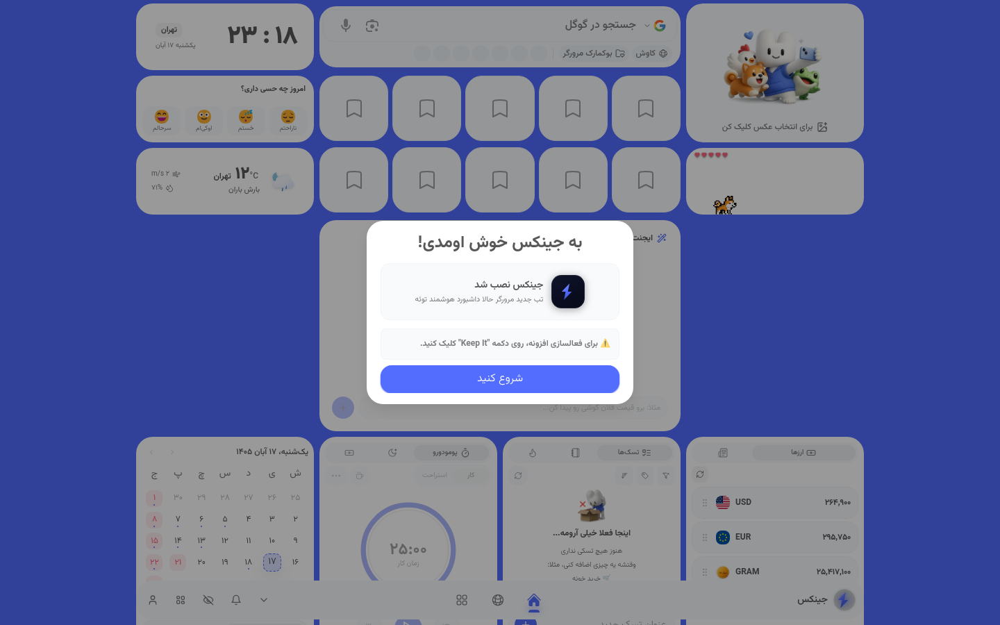

# 🧞 Jinx | جینکس

**A smart new-tab dashboard with an AI agent that controls your browser — live currency & gold prices, weather, Persian calendar, todos, bookmarks, wallpapers and a full widget system.**

`v27.2.0` · Chrome (Manifest V3) + Firefox

**🌐 Website:** [jinx.metora.ir](https://jinx.metora.ir) · **Developer:** [metora.ir](https://metora.ir)

**📖 Persian docs:** [README-fa.md](README-fa.md)

---

## 📖 Overview

Jinx replaces your browser's new tab with a **smart, Persian-first dashboard**. It is built on top of the source code of [**Widgetify**](https://widgetify.ir/) — the popular Iranian smart new-tab extension — and it is **completely free**: every feature is open for everyone, no paywalls, no subscriptions. It bundles a live-data dashboard (currency, gold, weather), productivity widgets (todos, habits, notes, pomodoro, bookmarks, calendar) and a **browser-controlling AI agent** powered by Metora's own AI models (`jinx-1-air`, `jinx-3-legion`).

Everything the dashboard needs to render is **shipped inside the extension** — Persian fonts (Samim & Vazirmatn), bundled wallpapers, sounds and icons — so your new tab paints instantly, even on a slow connection.

> The screenshot shows the real dashboard on first run: Tehran clock & date, mood picker, weather, bookmark tiles, the virtual pet, Persian calendar, pomodoro, notes and the live USD / EUR / gold widget — plus the AI button in the bottom dock.

## ✨ Features

**🤖 Jinx AI agent**
- A conversational agent that can **control the browser**: open and search tabs, act on pages, and answer questions
- Powered by Metora's in-house models **Jinx-1-Air** and **Jinx-3-Legion** (`api.metora.ir/v1`)
- Available everywhere from the floating AI button in the bottom dock

**📊 Live dashboard**
- 💱 **Currency & gold** — live USD, EUR, gold and gram prices with daily change, auto-refreshed and cached
- 🌤️ **Weather** — current conditions for your city
- 📅 **Persian (Jalali) calendar** + world clock with custom time zones
- 📰 **RSS feeds** — add your own sources as a feed widget

**🧩 Widget system**
- 10+ widgets on a draggable **grid layout**: add, resize, move, duplicate and remove
- **Combo widgets** — pack several mini-tools into one tile
- **Canvas mode** and per-widget settings and variants

**✅ Productivity**
- **Todos & habits** — daily targets, custom frequency, streaks, tags and date filters
- **Notes** — quick personal notes on your new tab
- **Pomodoro** timer with focus sessions
- **Bookmarks** — visual bookmark tiles with drag & drop folders

**🎨 Personalization**
- 🖼️ **Wallpapers** — bundled wallpapers plus remote collections, with blur and tag filters
- 😀 **Mood picker** — "How do you feel today?"
- 🐴 **Virtual pet** — a little companion living on your dashboard
- 👥 **Friends** — add friends and share your setup
- 🔔 **Alarms & sounds** — market and task alarms (bundled audio)

**👨‍💼 Account**
- Sign in with a **Metora account** to sync your layout across devices
- **100% free** — no subscriptions, no paywalls, no locked features

## 🧱 Architecture

This repository contains the **official production build** of the extension.

| Path | What it is |
|---|---|
| `manifest.json` | Extension manifest (MV3) — permissions, icons, new-tab override |
| `background.js` | MV3 **service worker** — messaging hub between the dashboard, tabs and the AI service |
| `newtab.html` | Entry point that replaces the browser's new tab |
| `chunks/` | Vite code-split React modules (dashboard, auth, billing, widgets, AI…) |
| `assets/` | Bundled Persian fonts (**Samim**, **Vazirmatn**), wallpapers, sounds, CSS |
| `cdn/` | Additional media: help clips, alarms, illustrations |
| `icons/` | Toolbar and store icons (16 → 512 px) |

**Extension IDs used by the build:** Firefox add-on id `jinx@metora.ir` (Gecko ≥ 115). Chrome installs are handled through the Web Store or "Load unpacked".

## 📦 Installation

**Chrome / Edge / any Chromium browser**

1. Download this repository (`Code → Download ZIP`) and unzip it — or `git clone` it.
2. Open `chrome://extensions`.
3. Turn on **Developer mode** (top right).
4. Click **Load unpacked** and select the repository folder (the one containing `manifest.json`).
5. Open a new tab — Jinx takes over. 🎉

**Firefox**

1. Open `about:debugging#/runtime/this-firefox`.
2. Click **Load Temporary Add-on…** and pick `manifest.json`.
3. Open a new tab. (Temporary add-ons are removed when Firefox restarts.)

> 💡 If another new-tab extension is installed, keep only one — they fight over the new tab. When Chrome asks, confirm the dashboard with **Keep It**.

## 🔐 Permissions & privacy

Jinx is a dashboard *and* a browser agent, so it asks for more than a typical extension. What each permission is for:

| Permission | Why |
|---|---|
| `storage`, `unlimitedStorage` | Your layout, widgets, notes and settings live locally in the browser |
| `tabs` | Bookmark tiles, tab count badge, and tab actions for the AI agent |
| `search` | The AI agent and the search box can run web searches |
| `scripting`, `activeTab` | Page actions requested through the AI agent |
| `tabGroups`, `bookmarks`, `identity` *(optional)* | Granted only when you use the related features |
| Host permissions (`api.metora.ir`, `api.widgetify.ir`, …) | Live currency/gold data, wallpapers, AI service and account sync |

- Dashboard data (notes, todos, layout) is stored **locally first**; the optional Metora account is what syncs it.
- The AI agent only reaches pages when **you** ask it to act.
- Firefox build declares data collection as `none` required, with technical/interaction data strictly optional.

## 🛠️ Troubleshooting

| Problem | Fix |
|---|---|
| New tab doesn't change | Remove/disable other new-tab extensions, then reload Jinx in `chrome://extensions` |
| Prices or weather don't load | Check the connection to `api.metora.ir` / `api.widgetify.ir`; the widget retries automatically |
| "Load unpacked" rejected | Make sure you selected the folder that directly contains `manifest.json` |
| Dashboard feels slow on first run | Fonts and wallpapers are cached after the first load |
| Firefox removed the add-on | Temporary add-ons disappear on restart — load it again via `about:debugging` |

## 🗺️ Roadmap

- [ ] Chrome Web Store listing
- [ ] More widget themes and layouts
- [ ] Deeper AI-agent page actions
- [ ] iOS / Android companion dashboards

## 🤝 Contributing

This repo hosts the production build. Bug reports and feature ideas are very welcome — open an issue and include your browser, version (`27.2.0`) and a screenshot.

## 🪶 Credits & Attribution

Jinx is built from the source code of [**Widgetify**](https://widgetify.ir/) — the smart new-tab extension by the Widgetify team. The dashboard architecture, the widget grid, the bundled wallpapers pipeline and the live-data services (`api.widgetify.ir`) originate from that project. Huge thanks to the Widgetify team for making their source code available.

On top of that base, Metora added the **Jinx AI agent** (Jinx-1-Air / Jinx-3-Legion), Persian-first refinements and its own branding — and ships the result here as a **completely free**, MIT-licensed extension.

## 📄 License

Released under the [MIT License](LICENSE).

---

**Built by [Metora](https://metora.ir) — Benyamin Karimi & Pooriya Esmael zadeh**

🪶 **Based on [Widgetify](https://widgetify.ir/)** · 🌐 [jinx.metora.ir](https://jinx.metora.ir)

⭐ Star this repo if Jinx makes your new tab smarter!

